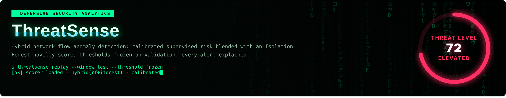
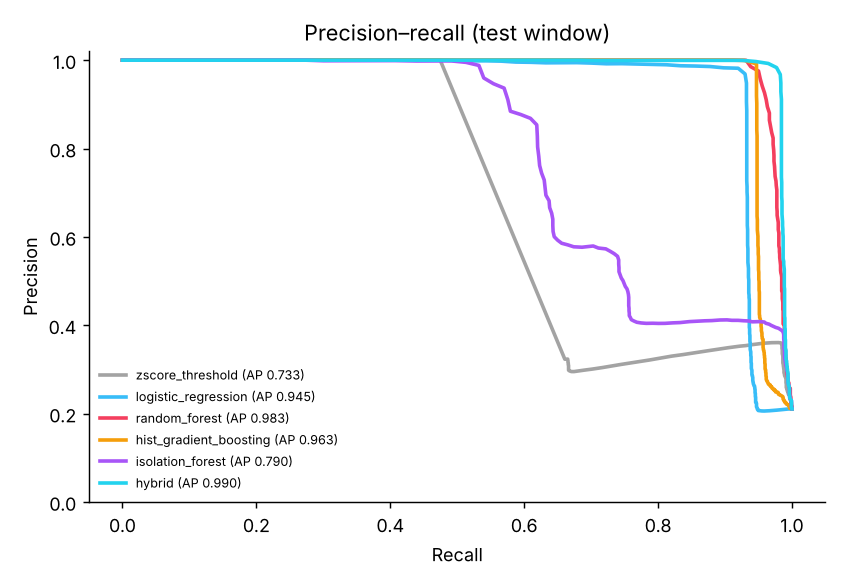
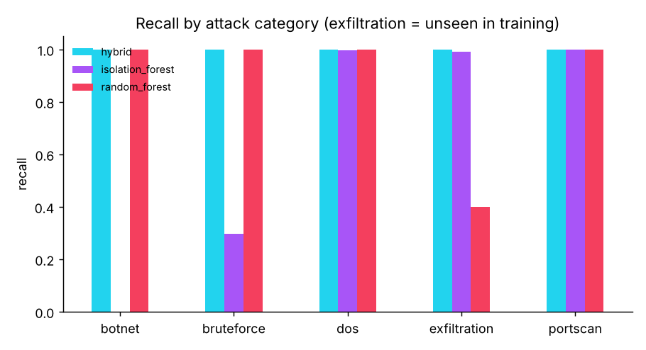
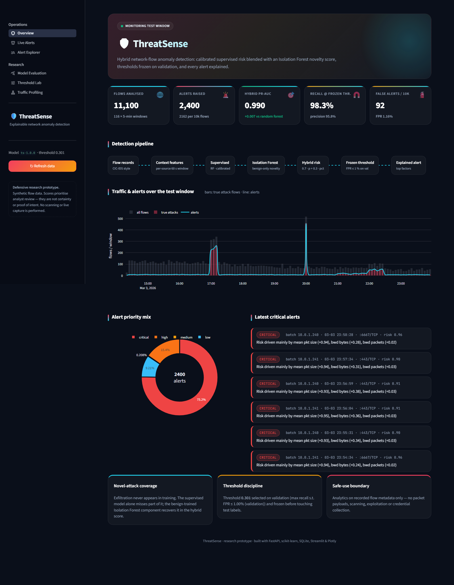
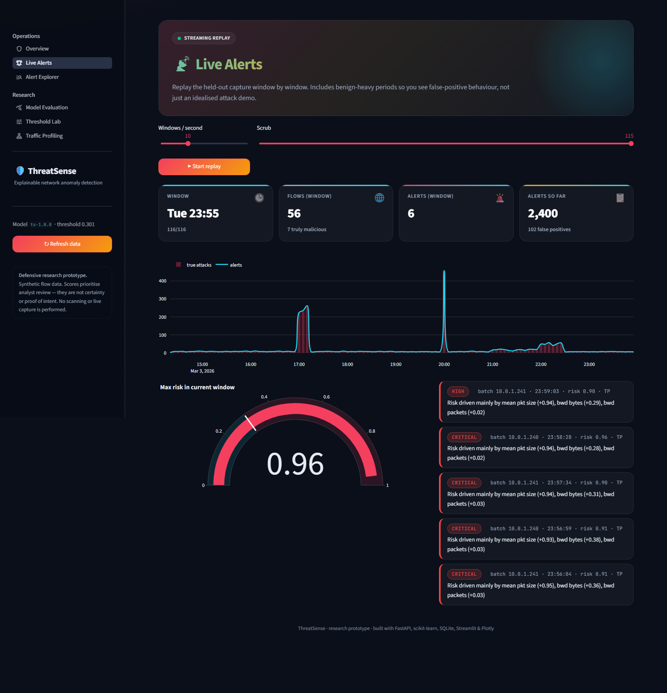
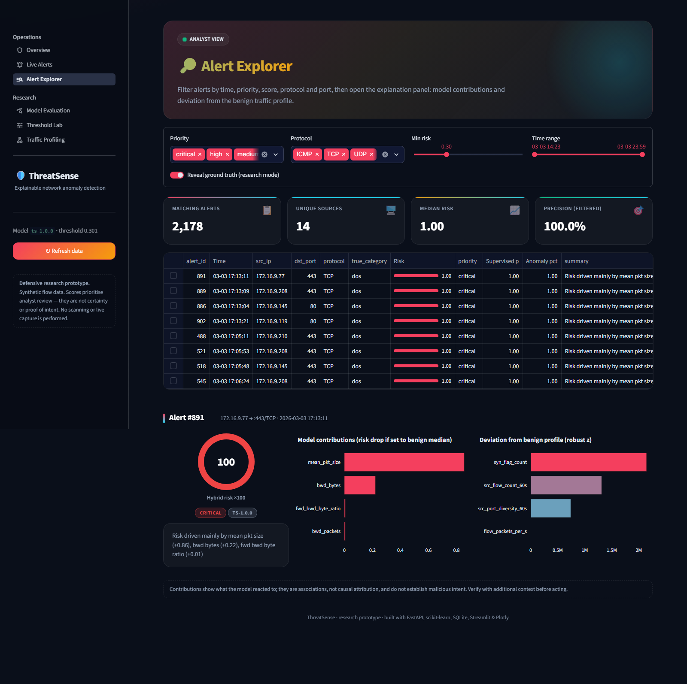
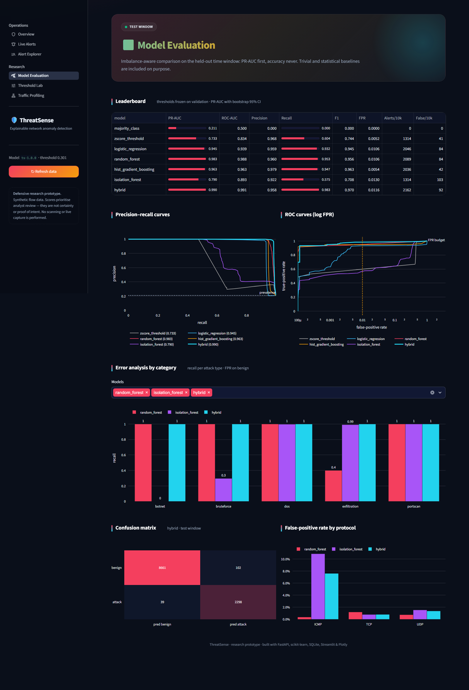
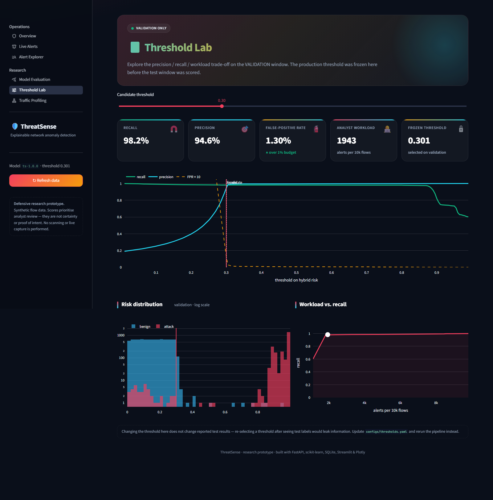
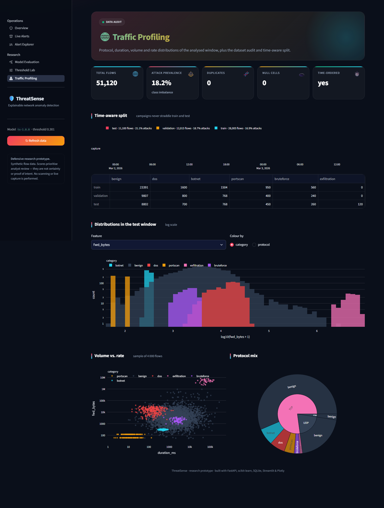
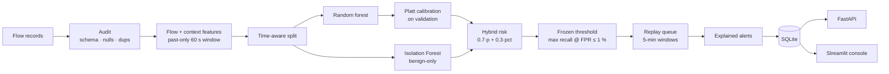

<p align="center">
  
</p>

<h1 align="center">ThreatSense</h1>
<p align="center"><b>Explainable network anomaly detection & streaming security analytics</b><br/>
Analyses network-flow records, flags unusual traffic, prioritises suspicious events and explains why each alert fired —
evaluated honestly under heavy class imbalance.</p>

<p align="center">
  <a href="https://github.com/Padu28/threatsense/actions/workflows/ci.yml"></a>
  
  
  
  
  
  
</p>

<p align="center">
  <a href="#-highlights">Highlights</a> · <a href="#-results">Results</a> · <a href="#-screenshots">Screenshots</a> ·
  <a href="#-quick-start">Quick start</a> · <a href="#-api">API</a> · <a href="#-how-it-works">How it works</a> ·
  <a href="#%EF%B8%8F-limitations--safe-use">Safe use</a>
</p>

> **Defensive analytics project.** Works on recorded flow metadata only — no scanning, exploitation, credential
> collection or live traffic capture. Not a production security control.

---

## ✨ Highlights
- **Hybrid detector:** Platt-calibrated random forest blended with a benign-only Isolation Forest — catches an attack type **never seen in training**.
- **Honest imbalance evaluation:** PR-AUC first, trivial and statistical baselines included, bootstrap CIs, analyst-workload metrics (alerts per 10 k flows).
- **No threshold leakage:** the alert threshold is chosen on the validation window (max recall at FPR ≤ 1 %) and **frozen** before testing.
- **Leakage-safe features:** per-source context (flow count, port diversity) computed from strictly *past* flows only.
- **Streaming replay:** producer/consumer queue over 5-minute windows with a Kafka-ready source interface.
- **Every alert explained:** model contributions + deviation from the benign traffic profile, in a "SOC Terminal" analyst console.

## 🔬 Research question
> **Can a hybrid pipeline — calibrated supervised risk + unsupervised anomaly score + explainable alert features —
> improve detection quality while keeping false positives manageable?**

## 📊 Results
*Held-out time window (11 100 flows, 21 % malicious), threshold frozen on validation.*

| Model | PR-AUC (95 % CI) | Recall | Precision | FPR | False alerts / 10 k |
|---|---|---|---|---|---|
| Majority class | 0.211 | 0.000 | — | 0.0000 | 0 |
| Robust z-score threshold | 0.733 (0.718–0.747) | 0.604 | 0.968 | 0.0052 | 41 |
| Logistic regression | 0.945 (0.938–0.954) | 0.932 | 0.959 | 0.0106 | 84 |
| Random forest | 0.983 (0.979–0.986) | 0.953 | 0.960 | 0.0106 | 84 |
| HistGradientBoosting | 0.963 (0.956–0.969) | 0.947 | 0.979 | 0.0054 | 42 |
| Isolation Forest (benign-only) | 0.790 (0.778–0.801) | 0.575 | 0.922 | 0.0130 | 103 |
| **Hybrid (RF + IF)** | **0.990 (0.987–0.992)** | **0.983** | 0.958 | 0.0116 | 92 |

| Novel attack (absent from training) | Random forest | Isolation Forest | **Hybrid** |
|---|---|---|---|
| Exfiltration recall | 0.40 | 0.99 | **1.00** |

<p align="center">
  
  
</p>

> **Honest reading.** The hybrid's exfiltration catch is *marginal* (mean risk ≈0.31 vs threshold ≈0.30) — a weighted
> average dilutes a strong single signal, so max-fusion is the next experiment. Test FPR (1.16 %) is slightly above
> the 1 % validation budget. Full report: [`reports/evaluation_report.md`](reports/evaluation_report.md).

## 📸 Screenshots
<table>
  <tr>
    <td width="50%"><br/><sub><b>Overview</b> — matrix hero, threat gauge, traffic vs alerts, critical alerts</sub></td>
    <td width="50%"><br/><sub><b>Live Alerts</b> — streaming replay with TP/FP-labelled alert feed</sub></td>
  </tr>
  <tr>
    <td><br/><sub><b>Alert Explorer</b> — filter, select, see why it fired</sub></td>
    <td><br/><sub><b>Model Evaluation</b> — leaderboard, PR & log-ROC, per-category recall</sub></td>
  </tr>
  <tr>
    <td><br/><sub><b>Threshold Lab</b> — recall / precision / workload trade-off (validation only)</sub></td>
    <td><br/><sub><b>Traffic Profiling</b> — audit, time split, distributions</sub></td>
  </tr>
</table>

## 🚀 Quick start
**Requirements:** Python 3.11 or 3.12 · no GPU.

<details open>
<summary><b>Windows (PowerShell)</b></summary>

```powershell
git clone https://github.com/Padu28/threatsense.git
cd threatsense
py -3.12 -m venv .venv
.\.venv\Scripts\Activate.ps1
pip install -r requirements-dev.txt
pip install -e .
python -m threatsense.cli pipeline                     # ≈35 s
streamlit run dashboard/app.py --server.port 8502      # → http://localhost:8502
```
</details>

<details>
<summary><b>macOS / Linux</b></summary>

```bash
git clone https://github.com/Padu28/threatsense.git && cd threatsense
python3.12 -m venv .venv && source .venv/bin/activate
pip install -r requirements-dev.txt && pip install -e .
python -m threatsense.cli pipeline
streamlit run dashboard/app.py --server.port 8502
```
</details>

<details>
<summary><b>Docker</b></summary>

```bash
docker build -f docker/Dockerfile -t threatsense .
docker run -p 8001:8001 -p 8502:8502 threatsense
```
</details>

**API:** `uvicorn api.main:app --reload --port 8001` → http://localhost:8001/docs

## 🔌 API
| Method | Endpoint | Purpose |
|---|---|---|
| `GET` | `/health` | Status, model version, scorer readiness |
| `POST` | `/score` | Score one flow → risk, priority, components, top factors |
| `POST` | `/score/batch` | Score up to 5 000 flows |
| `GET` | `/alerts` | Stored alerts (filter by priority / min risk) |
| `GET` | `/stats` | Frozen threshold, test metrics, split info |
| `GET` | `/windows` | Per-window replay statistics |

```bash
curl -X POST localhost:8001/score -H "Content-Type: application/json" -d '{"dst_port":31337,"duration_ms":8,
 "fwd_packets":1,"bwd_packets":1,"fwd_bytes":60,"bwd_bytes":54,"rst_flag_count":2,"ack_flag_count":1,
 "src_flow_count_60s":180,"src_port_diversity_60s":175}'
```
```json
{ "risk": 0.999, "alert": true, "priority": "critical", "threshold": 0.3006,
  "summary": "Risk driven mainly by mean pkt size (+0.89), bwd bytes (+0.26), ...",
  "disclaimer": "Risk score for triage only — not a determination of malicious intent." }
```

## 🏗 How it works

Dataset details and the CIC-IDS2017 adapter: [`docs/DATA_CARD.md`](docs/DATA_CARD.md)

## 📁 Project structure
```
threatsense/
├── configs/              dataset.yaml · features.yaml · thresholds.yaml
├── src/threatsense/
│   ├── ingestion/        synthetic capture · CIC-IDS2017 loader · audit
│   ├── preprocessing/    train-only ColumnTransformer
│   ├── features/         flow ratios · past-only source context · time split
│   ├── detection/        baselines · LR/RF/HGB · calibration · Isolation Forest
│   ├── scoring/          frozen threshold · hybrid risk · priority bands
│   ├── explainability/   substitution contributions · benign deviation
│   ├── streaming/        replay source + producer/consumer queue
│   ├── evaluation/       imbalance metrics · bootstrap CIs · figures
│   ├── storage/          SQLite event store
│   └── pipeline.py
├── api/ · dashboard/ ("SOC Terminal" design) · notebooks/ · tests/ (20) · reports/ · scripts/ · docs/ · docker/
```

## ✅ Testing
`pytest -q` — 20 tests: determinism, past-only context features, time split, novel-attack placement, FPR budget,
calibration, explanations, streaming order, API. CI also runs the full pipeline and a Docker build.

## ⚠️ Limitations & safe use
- Synthetic traffic is far more separable than real captures — expect lower scores on CIC-IDS2017 / UNSW-NB15.
- Scores support analyst triage; they are **not** certainty and do not establish intent.
- Explanations are model associations, not causal attribution.
- No claim that the tool detects all attacks or is suitable for production SOC use.

## 🔗 Related projects
| Project | Focus |
|---|---|
| 🛰️ [SentinelML](https://github.com/Padu28/sentinelml) | Drift monitoring & adaptive retraining |
| 🔬 [VisionGuard AI](https://github.com/Padu28/visionguard-ai) | Robust visual defect inspection |
| 🩺 [MedPredict Research](https://github.com/Padu28/medpredict-research) | Calibrated, fair clinical risk models |

## 👤 Author
**Padmashree Shah** · [GitHub](https://github.com/Padu28)

<sub>MIT licensed · defensive research prototype · not affiliated with or endorsed by Microsoft.</sub>
